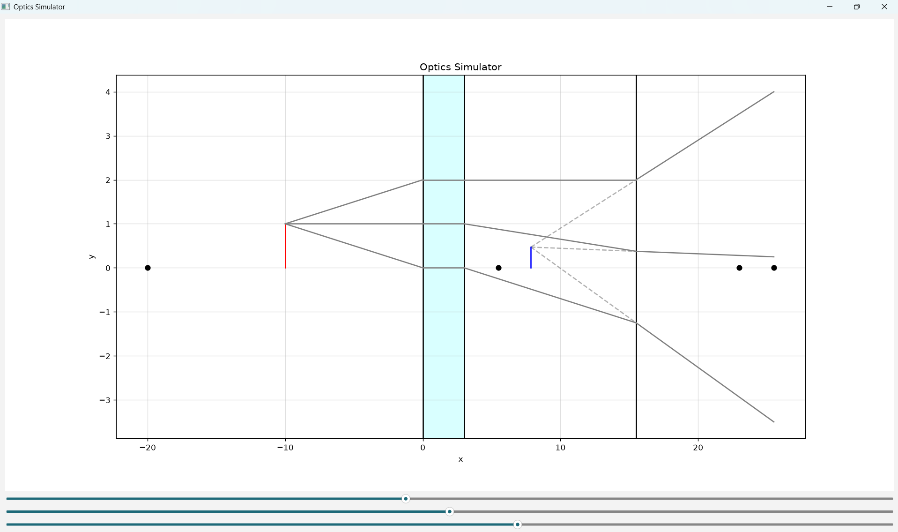

# Paraxial Geometric Optics Simulator



An interactive lens ray-tracing simulator built with Python, `NumPy`, `Matplotlib`, and `PyQt6`. Supports arbitrary sequences of converging and diverging thin and thick lenses with real-time object and lens position sliders.

## Physics & Ray-Tracing Model

Rays are traced as piecewise-linear segments $(x_i, y_i, s_i)$, where $s_i = \tan\theta_i$ is the ray slope in the paraxial approximation.

At each lens, whose left principal plane is located at $x = x_L$ and right one at $x = x_L + d$, with focal length $f$:

1. **Free-space propagation** from the previous plane $x_i$ to $x_{i+1} = x_L$:

$$
y_{i+1} = y_i + (x_L - x_i) s_i
$$

2. **Lens slope transformation**:

$$
s_{i+1} = s_i - \frac{y_{i+1}}{f}
$$

3. **Parallel propagation between principal planes** from $x_{i+1} = x_L$ to $x_{i+2} = x_L + d$:

$$
y_{i+2} = y_{i+1}
$$

4. **Image Localization**: Computes the intersection of outgoing principal rays to locate real or virtual images (handling collimated parallel rays at $\infty$).

## Interactive Features

- **Real-time Sliders (`PyQt6`)**: Adjust the object position and each individual lens position with $0.25$ spatial resolution.
- **Automatic Lens Sorting**: Lenses can be dragged past one another; the optical train automatically re-sorts along the optical axis and recalculates ray segments and image coordinates.

## Project Structure

- `optics.py` — `Obj`, `Ray`, `Lens`, and `OpticalSystem` classes plus paraxial ray propagation (`calculate_ray`) and intersection solver (`find_image`).
- `gui.py` — `PyQt6` interactive window with embedded `Matplotlib` canvas and sliders.
- `plotting.py` — Renders object, lenses with focal points $\pm f$, principal rays, and resulting image.
- `main.py` — Entry point configuring the initial optical setup.

## Installation & Usage

```bash
pip install -r requirements.txt
python main.py
```
