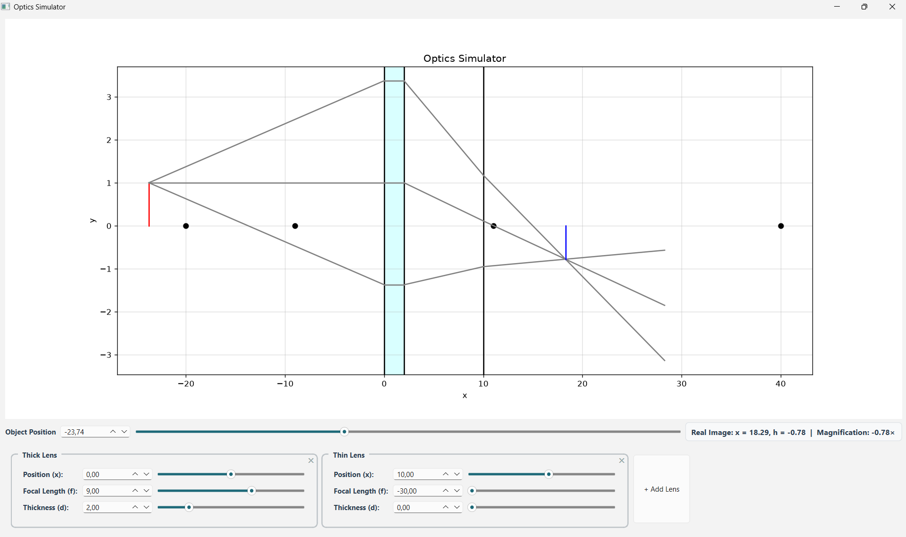

# Interactive Paraxial Optics & Lens System Simulator
[](https://www.python.org/)
[](https://riverbankcomputing.com/software/pyqt/)
[](https://numpy.org/)
[](https://matplotlib.org/)

An interactive, real-time geometric optics simulator built in Python with `PyQt6`, `NumPy`, and `Matplotlib`. The application models arbitrary optical trains consisting of thin and thick lenses, calculates piecewise paraxial ray propagation, and dynamically reconstructs real and virtual images.

---
## Key Features
- **Dynamic Optical Train:** Dynamically add (`+ Add Lens`) and delete (`✕`) lenses at runtime.
- **Thick & Thin Lens Modeling:** Adjust focal lengths ($f$), lens positions ($x$), and inter-principal-plane thicknesses ($d$) with synchronized sliders and high-precision spinboxes.
- **Double-Click Renaming:** Double-click any lens title in the GUI to assign custom labels (e.g., *Collimator*, *Objective*, *Eyepiece*).
- **Auto-Sorting Along Optical Axis:** Drag lenses past one another; the simulation automatically detects coordinate reordering and recalculates ray paths on the fly.
- **Real vs. Virtual Image Localization:** Computes exact focal intersections, displaying physical forward rays for real images and dashed backward projections for virtual images.
- **Live Optical Metrics:** Computes image position $x_{\text{img}}$, height $y_{\text{img}}$, lateral magnification $m$, and detects collimated beams ($x_{\text{img}} \to \infty$).
---
## Physics & Ray-Tracing Model
Rays are parametrized in the paraxial approximation by state vectors $\begin{pmatrix} y \\ s \end{pmatrix}$, where $y$ is the transverse distance from the optical axis and $s = \tan\theta \approx \theta$ is the ray slope.
At each lens with left principal plane $H_1$ at $x_L$, right principal plane $H_2$ at $x_L + d$, and focal length $f$:
1. **Free-Space Drift Matrix:** Propagation from plane $x_i$ to $x_{i+1} = x_L$:
   $$\begin{pmatrix} y_{i+1} \\ s_{i+1} \end{pmatrix} = \begin{pmatrix} 1 & x_L - x_i \\ 0 & 1 \end{pmatrix} \begin{pmatrix} y_i \\ s_i \end{pmatrix}$$
2. **Thin-Lens Refraction Matrix:**
   $$\begin{pmatrix} y_{\text{exit}} \\ s_{\text{exit}} \end{pmatrix} = \begin{pmatrix} 1 & 0 \\ -\frac{1}{f} & 1 \end{pmatrix} \begin{pmatrix} y_{\text{entry}} \\ s_{\text{entry}} \end{pmatrix}$$
3. **Principal Plane Transfer (Thick Lenses):**
   Within the thick lens medium between $H_1$ and $H_2$, rays translate without refraction:
   $$y(x_L + d) = y(x_L), \qquad s(x_L + d) = s(x_L)$$
4. **Image Localization:**
   The intersection of two outgoing non-parallel rays $(x_1, y_1, s_1)$ and $(x_2, y_2, s_2)$ yields the image coordinate:
   $$x_{\text{image}} = \frac{y_2 - y_1 + s_1 x_1 - s_2 x_2}{s_1 - s_2}, \qquad y_{\text{image}} = y_1 + s_1(x_{\text{image}} - x_1)$$
   - If $x_{\text{image}} > x_{\text{last\_lens}}$, the image is **Real**.
   - If $x_{\text{image}} \le x_{\text{last\_lens}}$, the image is **Virtual** (traced backwards with dashed projection lines).
   - If $s_1 \approx s_2$, rays are collimated and the image is formed at $\infty$.
---
## Interactive Controls
| Control | Action |
| :--- | :--- |
| **Object Slider / Spinbox** | Adjusts object axial position $x_{\text{obj}}$ and triggers real-time ray updates. |
| **Lens Slider / Spinbox** | Synchronously sets position ($x$), focal length ($f$), and thickness ($d$). |
| **Title Double-Click** | Inline rename lens labels directly in the group header. |
| **`✕` Button** | Deletes the lens from the optical system (minimum 1 lens retained). |
| **`+ Add Lens`** | Appends a new lens to the end of the optical train. |
---
## Project Structure
```text
optics_simulator/
├── main.py          # Application entry point & initial optical setup
├── optics.py        # OpticalSystem, Lens, Obj, Ray classes and solver logic
├── gui.py           # PyQt6 MainWindow and self-contained EditableLensBox widgets
├── plotting.py      # Matplotlib scene rendering (rays, lenses, focal points, image)
├── requirements.txt # Project dependencies
└── preview.png      # Application screenshot
```
---
## Installation & Usage
### 1. Clone the repository
```bash
git clone https://github.com/Michu-star/optics_simulator.git
cd optics_simulator
```
### 2. Set up a virtual environment (optional but recommended)
```bash
# Windows
python -m venv .venv
.venv\Scripts\activate
# macOS / Linux
python3 -m venv .venv
source .venv/bin/activate
```
### 3. Install dependencies
```bash
pip install -r requirements.txt
```
### 4. Run the simulator
```bash
python main.py
```